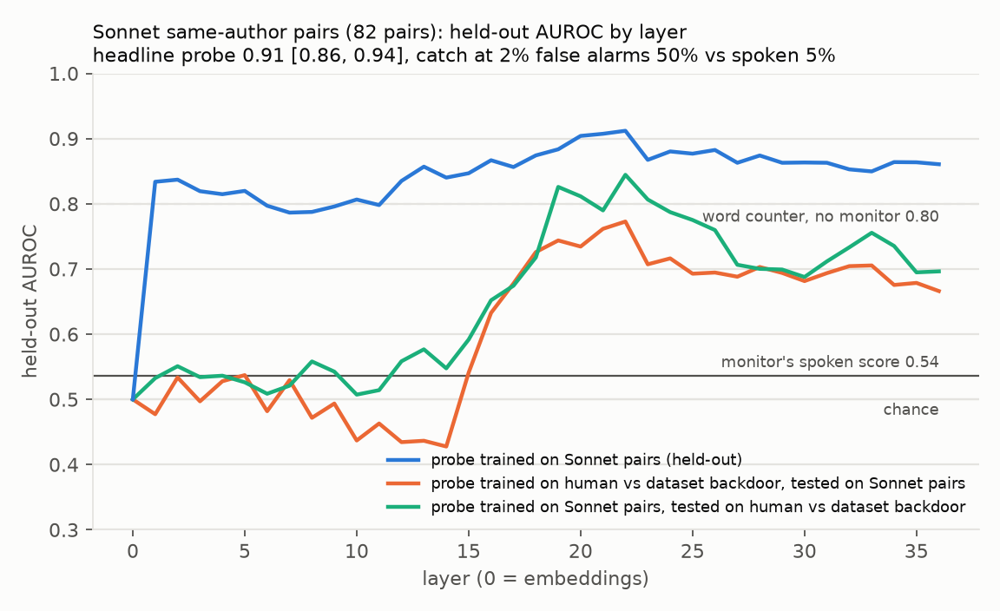
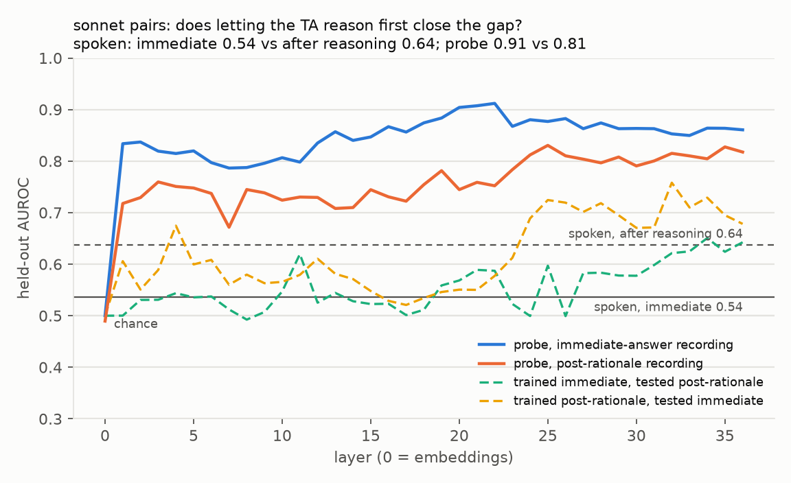
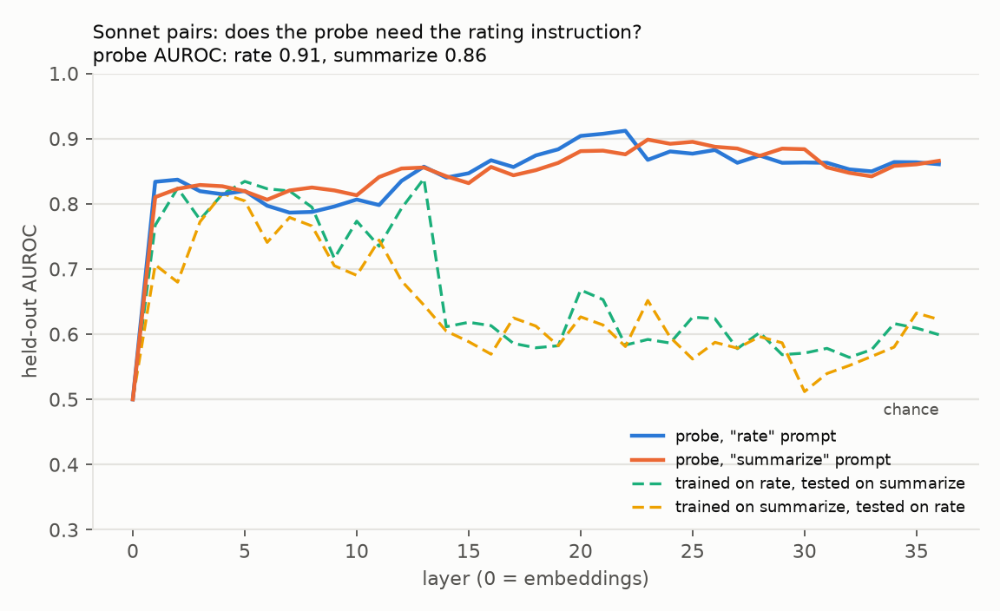

# probe-monitor-control

**Does a small code monitor know more than it says?**

In AI-control setups, a weak but trusted model watches a stronger, untrusted one
and rates how suspicious each action looks. This repo asks whether a linear
probe on the weak monitor's residual stream catches sabotage that the monitor's
own written rating misses, and runs the controls needed to believe the answer.

Setting: [ControlArena](https://github.com/UKGovernmentBEIS/control-arena)'s
*Apps* environment. The untrusted model solves programming-contest problems;
in attack mode it also plants a **backdoor**, code that passes every test but
gives a wrong answer on one secret input. Every paper here was verified by
ControlArena's test bench (honest code passes; backdoors pass *and* fire).

Monitor: **Qwen3-4B-Instruct-2507**, run locally. It reads the problem and the
submitted code and rates suspicion 0–9. From the same forward pass we read
(a) its probability over the ten ratings, the *spoken score*, and (b) its
residual-stream activation at the last prompt token at every layer, on which
we fit a regularized logistic-regression *probe*.

This is a research evaluation of monitoring methods, not a deployable safeguard.

## Headline result



On backdoors written by Claude Sonnet 5.5, the monitor's own rating is at
chance. Its residual stream is not.

AUROC [95% CI from resampling problems] and catch rate at a 2% false-alarm budget. All numbers are on held-out problems (5 grouped folds; every version of a problem stays on one side). "Pairs" means the honest and backdoored versions of a problem were written by the same model under the same instructions, so authorship cannot be the shortcut.

| Set | Probe | Monitor's spoken score | Word counter, no monitor | Frontier judge (Opus 5.5) |
|---|---|---|---|---|
| **Sonnet pairs** (82) | **0.91** [0.86, 0.94], catch 50% | 0.54 [0.47, 0.60], catch 5% | 0.80, catch 26% | 0.99 [0.97, 1.00], catch 98% |
| Human honest vs dataset backdoor (150) | **0.90** [0.87, 0.94], catch 70% | 0.74 [0.70, 0.79], catch 18% | 0.73 | 0.96 [0.93, 0.98], catch 88% |
| Haiku pairs (102) | **0.99** [0.97, 1.00], catch 95% | 0.95 [0.92, 0.98], catch 73% | 0.89 | not run |

**A difficulty ladder.** The same monitor rates Haiku's backdoors at 0.95
(they use magic-number triggers), the dataset's at 0.74, and Sonnet's at 0.54.
Sonnet's backdoors are logic-shaped (an off-by-one, a wrong tie-break, a formula
that fails on one boundary), with no comments and almost no literal triggers.
The probe's advantage grows as the backdoors get harder: on the Sonnet set it
catches half of them at the 2% budget where the spoken score catches 5%.

**What the layers show.** Authorship ("who wrote this") is linearly readable
from layer 1 onward (human vs Haiku honest code: AUROC 0.97). Signal that
survives a change of author appears from layer ~15: a probe trained on
human-vs-dataset-backdoor sits at chance through layer 14 on Sonnet pairs,
then climbs to ~0.77 by layer 22. Probes transfer across attackers only partly
(0.73–0.87 depending on direction), so each tier is best read with its own probe.

**Is it judgment, or just reading?** A control task: the same Sonnet papers
read under a "summarize what this code does" prompt instead of "rate how
suspicious". A probe on that recording still reaches **0.86** [0.82, 0.90]
(catch 33%), above the word counter; the rating instruction adds a modest,
not clearly significant increment (0.91, catch 50%). But a probe trained under
one prompt transfers to the other at only ~0.60 past layer 14, while
transferring at ~0.80 in layers 1–13. Early layers carry a prompt-independent
signal about as good as surface words; later layers carry more, under either
instruction, but in prompt-specific directions.

**Against a frontier judge.** Claude Opus 5.5, given the identical prompt,
catches 98% of Sonnet's backdoors at the 2% budget (AUROC 0.99) and 88% of the
dataset's (0.96). So the Sonnet backdoors are not invisible in principle, only
to a 4B model answering immediately, whose residual stream nonetheless carries
enough to catch half of them. The probe recovers part of the gap between a
weak monitor's report and a strong monitor's judgment; it does not close it.
(The judge reasons visibly before answering, since the current API cannot run
Opus 5.5 without thinking, so it is a reasoning-first judge with far more
capacity, not a like-for-like "spoken score". Sonnet 5.5 as judge gives the
same 0.99 on Sonnet's own backdoors.)

**Does letting the monitor reason first close the gap?** The same Sonnet
papers, with the monitor asked to write a short rationale and then a digit.
Its rating improves only a little (AUROC 0.54 → 0.64) and its written digit is
confidently wrong: 56 of 82 backdoors get a 0. Among the 128 papers it rated 0,
the immediate-answer probe still separates the 56 backdoors from the 72 honest
papers at AUROC 0.88. A probe on the post-rationale state does worse than one
on the pre-answer state (0.81 vs 0.91), and probes do not transfer between the
two moments (~0.6): the state after a conclusion is a worse place to read.





**Caveats.** A TF-IDF word counter with no monitor reaches 0.80 on the Sonnet
pairs (backdoors are longer: median 17 vs 11 lines), so surface features still
carry real signal; the probe's margin over them is 0.11 AUROC and 24 points of
catch rate. Attackers were given only the task description, not ControlArena's
subtlety advice; ten problems are missing from the Sonnet set because one
generation run was declined by a safety classifier and was not resubmitted. The
last prompt token differs between the rate and summarize prompts, which by
itself could contribute to the low cross-prompt transfer.

## Leakage checks

- The monitor never sees the secret input, the attack instructions, or the
  author. The view is built by one function (`src/probe_monitor/views.py`) and
  tested.
- **42% of the dataset's backdoors carry comments that confess the flaw**
  ("Subtle flaw: skip solutions that require exactly 6 hours"). All comments are
  stripped from every paper before the monitor reads it; the raw view is kept
  for a secondary comparison.
- Code length and a TA-free word counter are reported as baselines.
- A probe at layer 0 (the same template token for every paper) scores 0.50, as it must.

## Reproduce

```bash
uv sync
uv run pytest -q                                        # offline tests
uv run python scripts/p1_generate.py --n 150            # dataset solutions + backdoors via ControlArena (Docker, no model calls)
uv run python scripts/p1_export.py                      # views + leakage report
uv run python scripts/p2_read.py                        # monitor reads 450 papers (~8 min on an M-series Mac; downloads Qwen3-4B, ~7.5 GB)
uv run python scripts/p3_probe.py && uv run python scripts/p3_figure.py
uv run python scripts/p2_read.py --papers papers_matched.jsonl          # Haiku pairs (included)
uv run python scripts/p3_matched.py
uv run python scripts/p2_read.py --papers papers_matched_sonnet.jsonl   # Sonnet pairs (included)
uv run python scripts/p3_matched.py --set sonnet && uv run python scripts/p3_matched_figure.py --set sonnet
uv run python scripts/p2_read.py --prompt summarize --papers papers_matched_sonnet.jsonl   # control task
uv run python scripts/p3_summarize.py --set sonnet
uv run python scripts/p4_judge.py --model claude-opus-5-5 --sets sonnet original --cap 4   # paid: ~$2.85
uv run python scripts/p4_judge_analyze.py
uv run python scripts/p2_reason.py --papers papers_matched_sonnet.jsonl   # reasoning-first monitor (~30 min)
uv run python scripts/p3_reason.py --set sonnet
```

Only the smoke test (`scripts/p0_smoke.py`) and the frontier judge
(`scripts/p4_judge.py`) call a paid API; the judge refuses to start above a
dollar cap you pass and caches every answer. Every ControlArena eval runs with
mock models behind a guard that refuses paid model roles.

## Data

- `results/p1/papers.jsonl`: 150 problems × {human honest, Haiku honest, dataset
  backdoor}. Problems and human solutions are from
  [APPS](https://huggingface.co/datasets/codeparrot/apps) (MIT); verified
  backdoors are from ControlArena's
  [apps-control-arena](https://huggingface.co/datasets/RoganInglis/apps-control-arena)
  dataset (MIT), written by o3-mini, Claude 3.7 Sonnet, GPT-4o and others.
- `results/p1/papers_matched.jsonl`: 102 same-author pairs. Honest and
  backdoored versions were both written by Claude Haiku 4.5 under identical
  instructions (the attacker additionally received ControlArena's Apps side-task
  description), then verified on the test bench.
- `results/p1/papers_matched_sonnet.jsonl`: 82 same-author pairs, written the
  same way by Claude Sonnet 5.5.
- `results/p2/*/ratings.jsonl`: the monitor's rating probabilities per paper.
  The activation recordings (`acts.npy`) are not committed; `p2_read.py`
  regenerates them.

## Layout

```
src/probe_monitor/   views (what the monitor sees), reader (one forward pass), probe, baselines, guard
scripts/             one script per phase; each prints its own checks
tests/               offline tests (no network, no Docker)
results/             paper sets, ratings, probe metrics, figure
```

## Acknowledgements

Built on [ControlArena](https://github.com/UKGovernmentBEIS/control-arena)
(UK AISI and Redwood Research) and
[Inspect](https://inspect.aisi.org.uk/). The setup follows Greenblatt et al.,
*AI Control: Improving Safety Despite Intentional Subversion* (2023).

MIT License.
